# Анализ кластеризуемости признаков HuBERT на датасете L2-ARCTIC

## 1. Описание эксперимента
--
### Данные
| Параметр | Значение |
|---|---|
| Датасет | L2-ARCTIC |
| Число высказываний | 26 867 |
| Число акцентов | 6 (арабский, мандарин, хинди, корейский, испанский, вьетнамский) |
| Число дикторов | 24 (4 диктора на каждый акцент) |
| Признаки | Среднее по времени (mean-pool) скрытых состояний HuBERT-base |
| Размерность признаков | 768 |
| Анализируемые слои | 6, 9, 12 |

### Распределение данных по акцентам
| Акцент | Дикторы | Число высказываний |
|---|---|---|
| Arabic (арабский) | ABA, SKA, YBAA, ZHAA | 4 365 |
| Mandarin (мандарин) | BWC, LXC, NCC, TXHC | 4 524 |
| Hindi (хинди) | ASI, RRBI, SVBI, TNI | 4 524 |
| Korean (корейский) | HJK, HKK, YDCK, YKWK | 4 524 |
| Spanish (испанский) | EBVS, ERMS, MBMPS, NJS | 4 402 |
| Vietnamese (вьетнамский) | HQTV, PNV, THV, TLV | 4 528 |

### Ключевой вопрос
> **Группируются ли признаки HuBERT по акцентам или по идентичности диктора?**
> Если кластеры лучше соответствуют дикторам, чем акцентам — значит модель кодирует
> голос, а не акцент, что объясняет завышенные ~99% в первоначальной классификации.

### Методология
- **Снижение размерности:** PCA (50 компонент) → t-SNE / UMAP (2D)
- **Кластеризация:** K-Means с k=6 (по числу акцентов) и k=24 (по числу дикторов)
- **Метрики разделимости:** коэффициент силуэта, ARI (Adjusted Rand Index), NMI (Normalized Mutual Information)
- **Объём выборки для визуализации:** 8 000 высказываний на акцент (стратифицированно)

---

## 2. Метрики разделимости

### 2.1 Коэффициент силуэта

Силуэт измеряет, насколько плотно сгруппированы объекты своего кластера относительно чужого.
Диапазон: **1** = идеальное разделение, **0** = перекрытие, **< 0** = объект в чужом кластере.

| Слой HuBERT | Силуэт **по акценту** | Силуэт **по диктору** | Отношение (диктор / акцент) |
|---|---|---|---|
| 6 | 0.0237 | 0.0643 | **2.7×** |
| 9 | 0.0090 | 0.0197 | **2.2×** |
| 12 | 0.0180 | 0.0469 | **2.6×** |

**Вывод:** несмотря на то, что оба значения близки к нулю (пространство высокомерно и диффузно),
кластеры дикторов в **2.2–2.7 раза** плотнее кластеров акцентов. Признаки организованы
вокруг личности диктора, а не вокруг акцента.

### 2.2 Метрики кластеризации K-Means

ARI и NMI измеряют совпадение между найденными кластерами и известными метками.
Диапазон: **1** = идеальное совпадение, **0** = случайное совпадение.

#### Слой 6
| k | ARI vs акцент | NMI vs акцент | ARI vs диктор | NMI vs диктор |
|---|---|---|---|---|
| 6 | 0.263 | 0.397 | 0.205 | 0.502 |
| **24** | 0.309 | 0.648 | **0.864** | **0.917** |

#### Слой 9
| k | ARI vs акцент | NMI vs акцент | ARI vs диктор | NMI vs диктор |
|---|---|---|---|---|
| 6 | 0.196 | 0.259 | 0.149 | 0.350 |
| **24** | 0.237 | 0.478 | **0.575** | **0.696** |

#### Слой 12
| k | ARI vs акцент | NMI vs акцент | ARI vs диктор | NMI vs диктор |
|---|---|---|---|---|
| 6 | 0.181 | 0.276 | 0.166 | 0.416 |
| **24** | 0.278 | 0.587 | **0.771** | **0.853** |

**Главный результат:** K-Means с k=24 восстанавливает личность диктора с ARI=**0.864** (слой 6)
без каких-либо меток. Тот же эксперимент для акцентов (k=6) даёт лишь ARI=0.263.
Признаковое пространство **фундаментально организовано по дикторам**.

---

## 3. Визуализация

### 3.1 PCA — дисперсия

> Слой 6: `layer6/pca_variance.png`

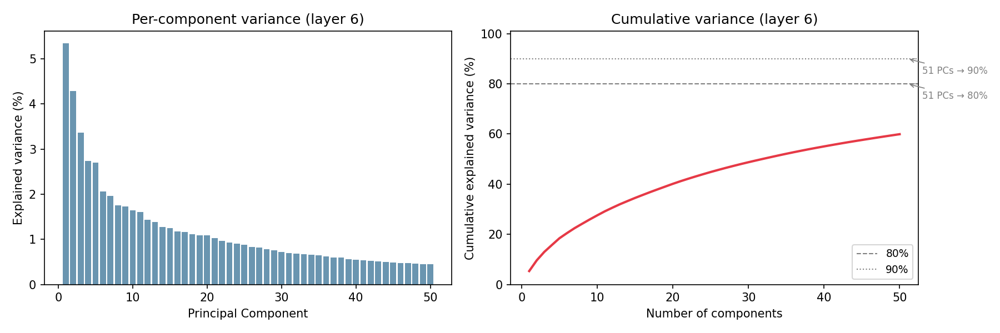

> Слой 9: `layer9/pca_variance.png`

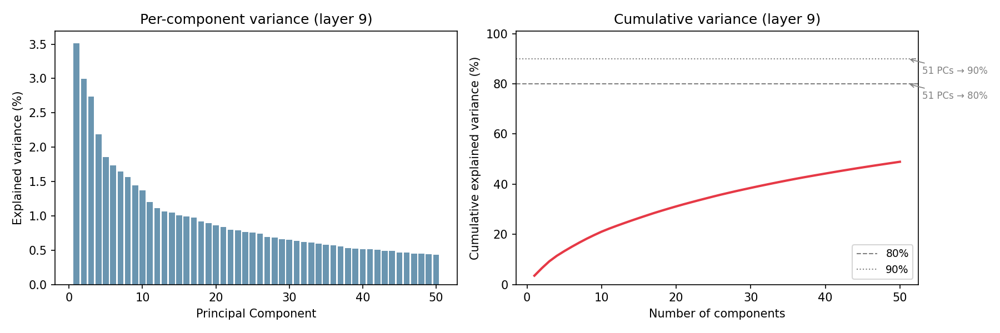

> Слой 12: `layer12/pca_variance.png`

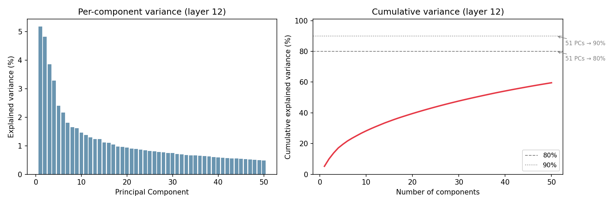

Первые 50 главных компонент объясняют значительную часть дисперсии, при этом ни одна компонента
не доминирует — признаковое пространство плотно и распределено, что согласуется с низкими
значениями силуэта.

---

### 3.2 PCA (PC1–PC2) — по акценту и по диктору

#### Слой 6
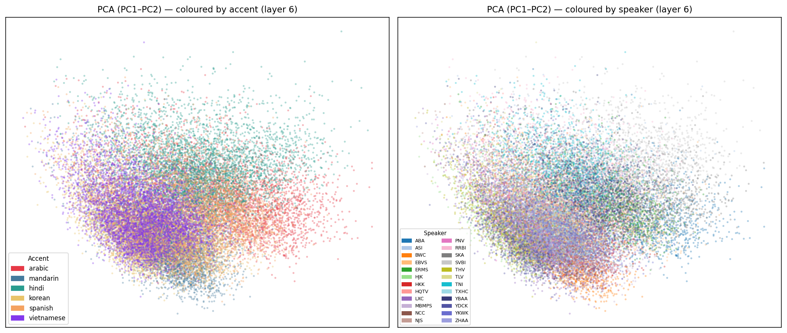

#### Слой 9
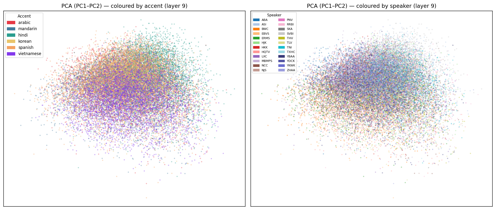

#### Слой 12
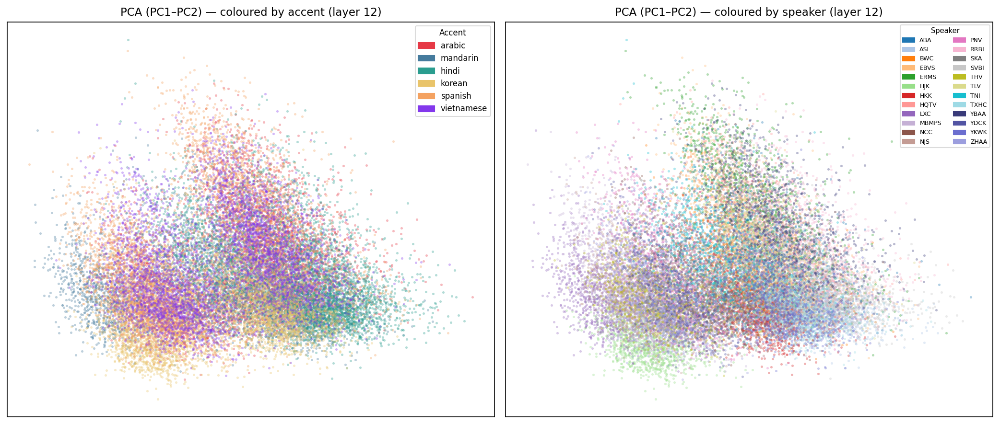

**Наблюдение:** На всех слоях акцентные группы сильно перекрываются на PCA-проекции (левые графики).
Правые графики, окрашенные по дикторам, показывают тенденцию к более локализованным подгруппам —
особенно выраженную на слое 6.

---

### 3.3 PCA (PC1–PC2–PC3) — 3D проекция по акценту

#### Слой 6
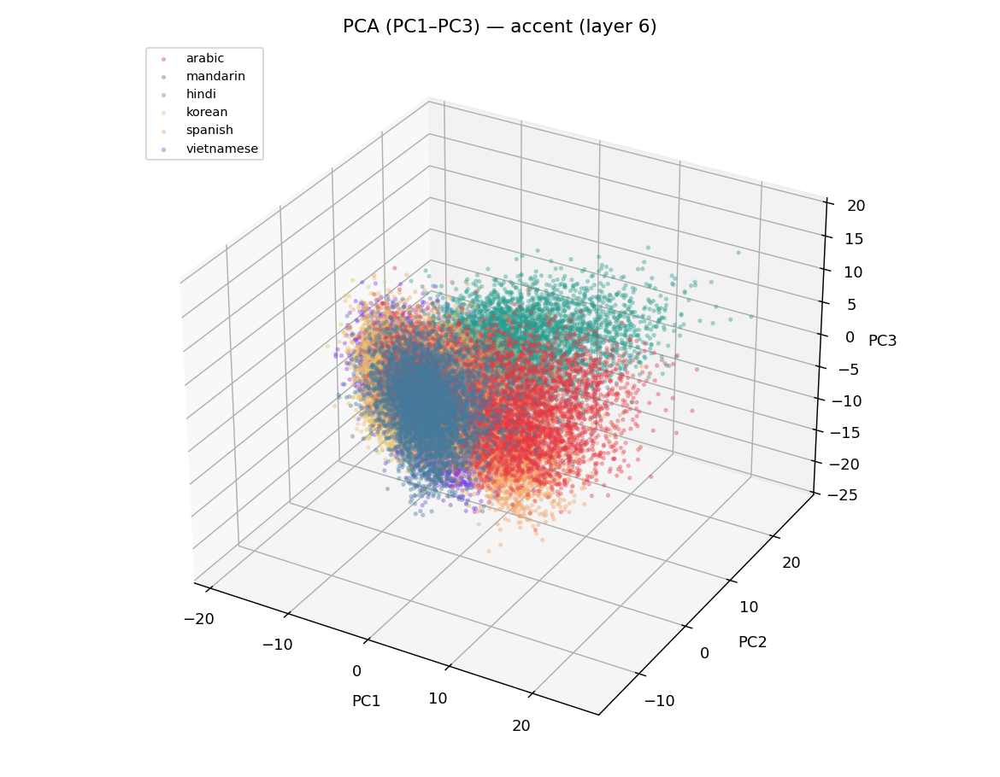

#### Слой 9
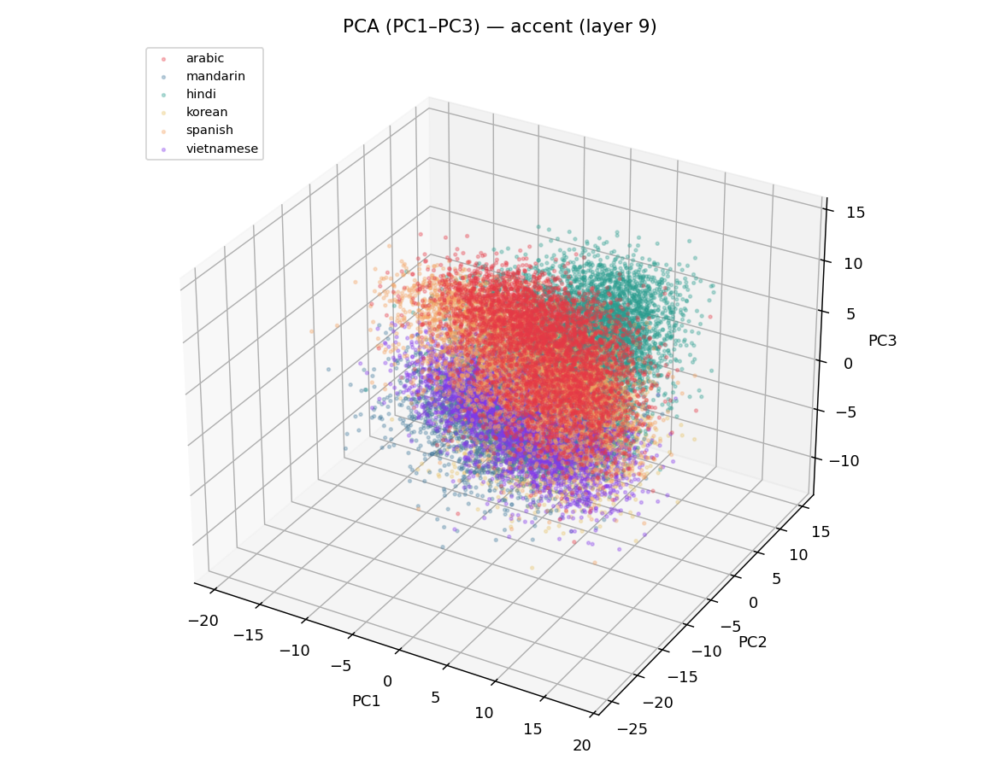

#### Слой 12
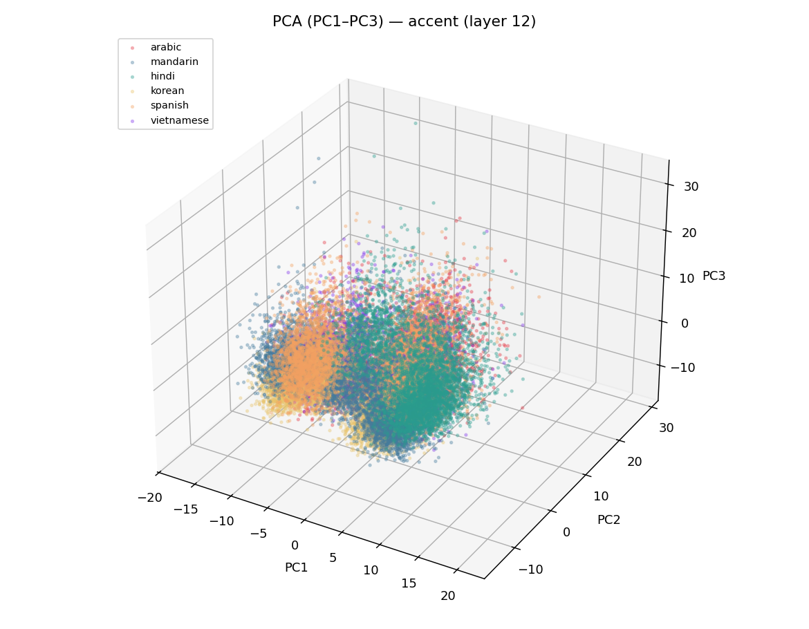

---

### 3.4 t-SNE — по акценту и по диктору

t-SNE нелинейно сжимает пространство, сохраняя локальную структуру соседей.

#### Слой 6
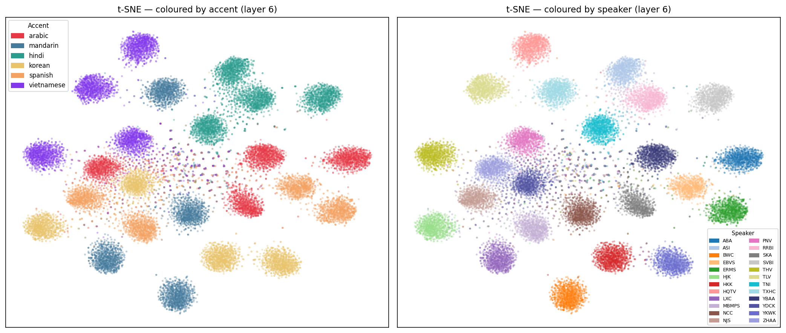

#### Слой 9
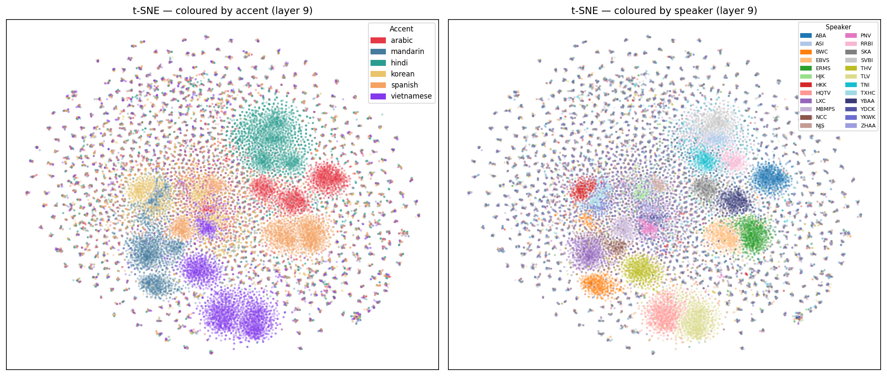

#### Слой 12
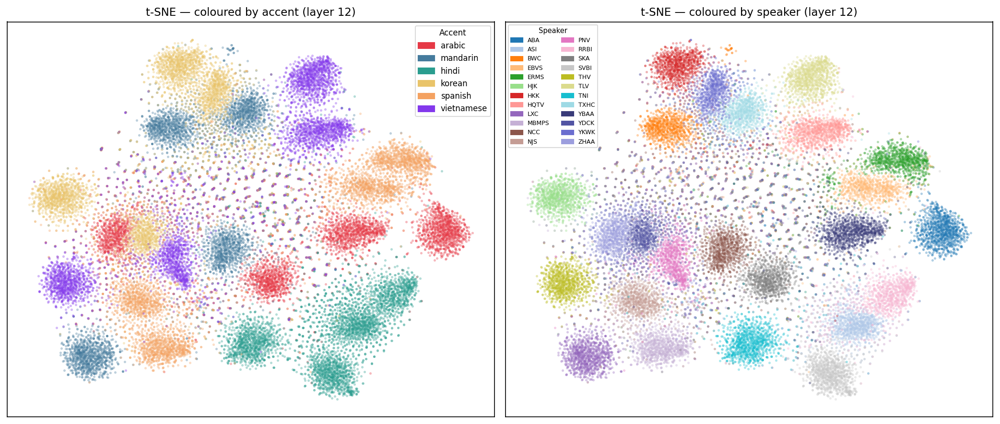

**Наблюдение:** t-SNE выявляет **24 компактных острова** (по одному на каждого диктора),
которые слабо группируются в 6 акцентных регионов. Это визуально подтверждает, что
модель кодирует голос, а не акцент.

---

### 3.5 UMAP — по акценту и по диктору

UMAP сохраняет как локальную, так и глобальную структуру лучше, чем t-SNE.

#### Слой 6
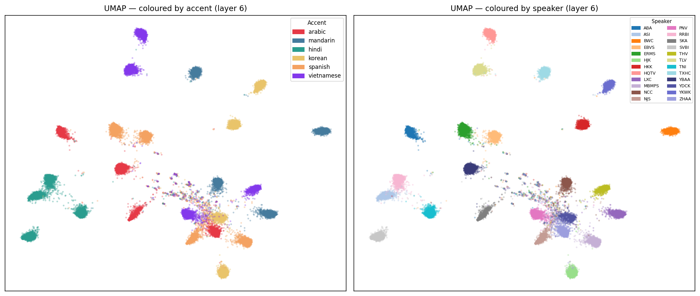

#### Слой 9
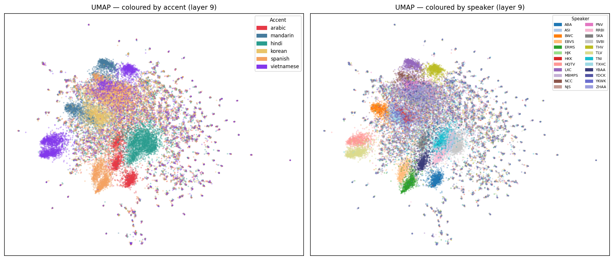

#### Слой 12
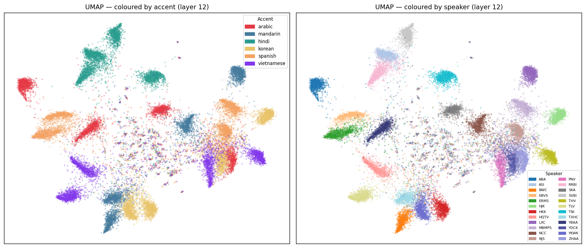

**Наблюдение:** На UMAP-проекции слоя 6 хорошо видны компактные кластеры по дикторам
(правый график). Акцентные границы (левый график) при этом размыты — несколько акцентных
групп перекрываются в центральной области.

---

### 3.6 Коэффициент силуэта — распределение по выборке

#### Слой 6
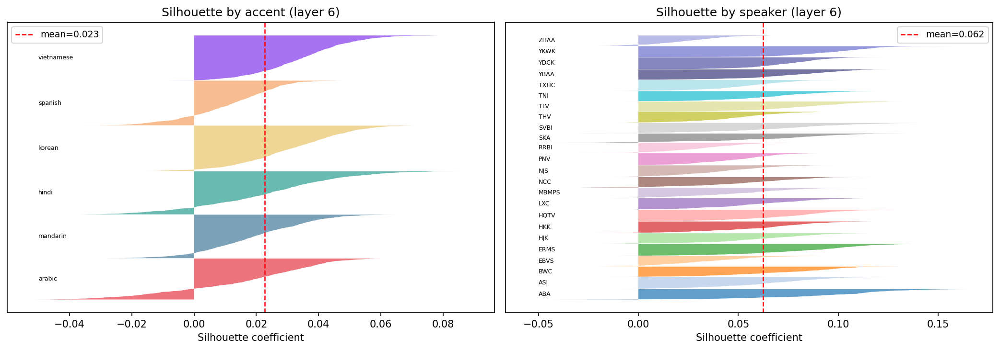

#### Слой 9
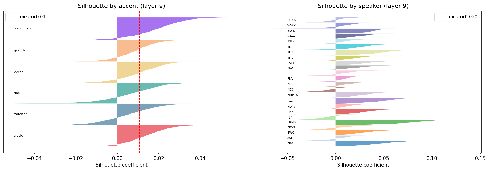

#### Слой 12
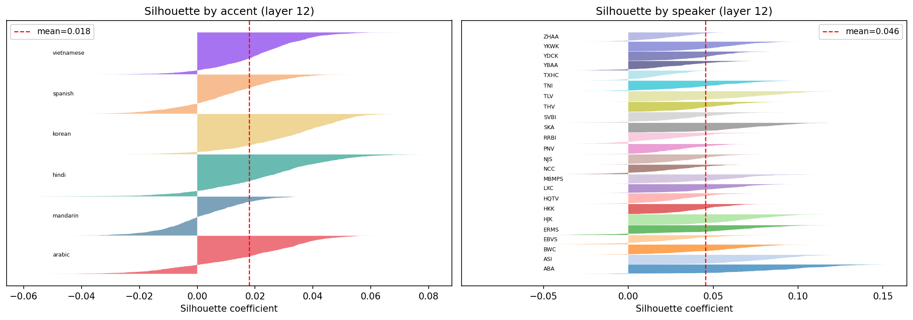

**Интерпретация:** Большинство образцов имеют силуэт близкий к нулю или отрицательный —
классы сильно перекрываются. Среднее силуэта по дикторам стабильно выше, чем по акцентам
на всех слоях.

---

### 3.7 Тепловая карта кластеров K-Means (k=6) vs. истинный акцент

#### Слой 6
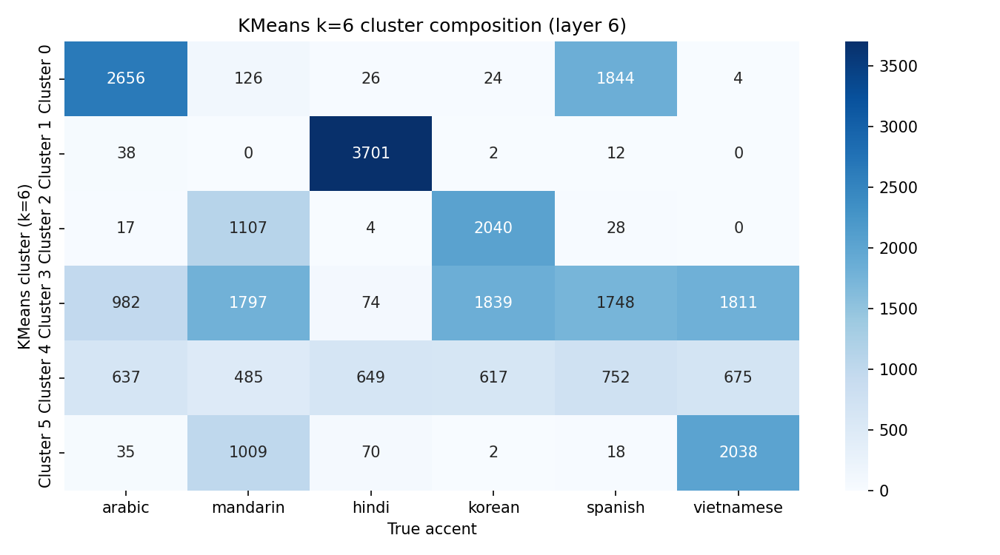

#### Слой 9
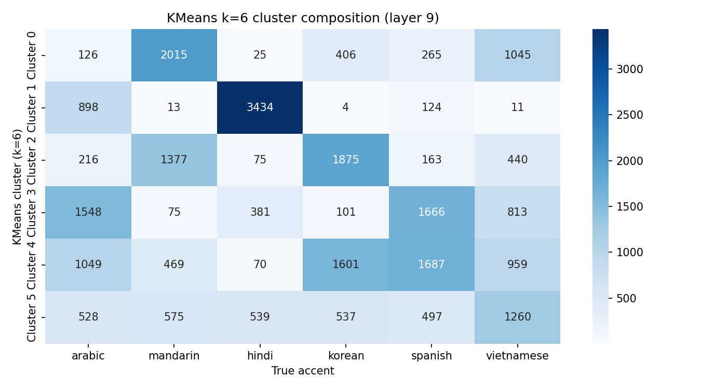

#### Слой 12
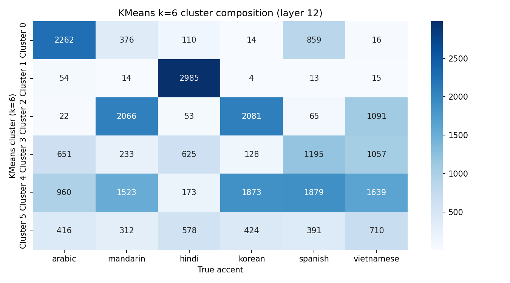

**Интерпретация:** Если бы данные были идеально разделимы по акцентам, каждая строка
(кластер) содержала бы образцы только одного акцента. На практике кластеры загрязнены
несколькими акцентами — наиболее выраженная привязка наблюдается лишь для отдельных пар.

---

## 4. Сводная таблица метрик по слоям

| Метрика | Слой 6 | Слой 9 | Слой 12 | Лучший слой |
|---|---|---|---|---|
| Силуэт (акцент) | 0.024 | 0.009 | 0.018 | 6 |
| Силуэт (диктор) | 0.064 | 0.020 | 0.047 | 6 |
| KMeans-6: ARI vs акцент | 0.263 | 0.196 | 0.181 | 6 |
| KMeans-6: NMI vs акцент | 0.397 | 0.259 | 0.276 | 6 |
| KMeans-24: ARI vs диктор | **0.864** | 0.575 | 0.771 | **6** |
| KMeans-24: NMI vs диктор | **0.917** | 0.696 | 0.853 | **6** |

---

## 5. Выводы

### 5.1 Данные не разделимы по акцентам «из коробки»

Все значения силуэта близки к нулю — в 768-мерном пространстве признаков HuBERT
акцентные группы значительно перекрываются. Задача классификации акцентов по
этим признакам является нетривиальной при переносе на новых дикторов.

### 5.2 Признаки HuBERT кодируют личность диктора сильнее, чем акцент

- K-Means c k=24 восстанавливает **индивидуальных дикторов** с ARI до 0.864
  (слой 6) без каких-либо меток
- Тот же алгоритм для акцентов (k=6) даёт лишь ARI=0.263
- Это объясняет завышенные ~99% в первоначальном эксперименте с произвольным
  разбиением: модель выучивала голоса, а не акценты

### 5.3 Слой 6 несёт наибольшую акустическую и идентификационную информацию

Слой 6 показывает наилучшие метрики как по акценту, так и по диктору.
Это согласуется с результатами классификации: именно на нём достигается
наивысшая точность в обоих протоколах оценки.

### 5.4 Слой 9 — наиболее «запутанный»

На слое 9 резко ухудшаются метрики по дикторам (ARI=0.575 vs 0.864 у слоя 6),
при этом акцентная структура также слабее. Это соответствует аномальному
поведению KNN (47% точности) на этом слое — соседство в пространстве признаков
теряет смысловую интерпретацию.

### 5.5 Мотивация для разреженных автоэнкодеров (SAE)

Признаки HuBERT **содержат** акцентный сигнал (ARI=0.263 значимо выше нуля),
но он **перемешан** с личностью диктора. Разреженные автоэнкодеры (SAE) призваны
**факторизовать** это пространство: выделить измерения, специфичные для акцента,
и отделить их от измерений, связанных с голосом конкретного диктора.
Успех этой факторизации позволит поднять точность при переносе на новых дикторов
с текущих 35–48% до потенциально значительно более высоких значений.

---

## 6. Файлы

```
outputs/clustering/
├── report.txt                          # исходный текстовый отчёт
├── clustering_report_ru.md             # данный отчёт
├── layer6/
│   ├── pca_variance.png                # объяснённая дисперсия PCA
│   ├── pca_scatter.png                 # PC1–PC2 по акценту и диктору
│   ├── pca_3d.png                      # 3D scatter PC1–PC2–PC3
│   ├── tsne_scatter.png                # t-SNE по акценту и диктору
│   ├── umap_scatter.png                # UMAP по акценту и диктору
│   ├── silhouette.png                  # силуэтный анализ
│   └── kmeans_heatmap.png              # матрица кластер × акцент
├── layer9/  (аналогично)
└── layer12/ (аналогично)
```
