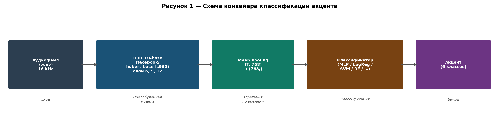
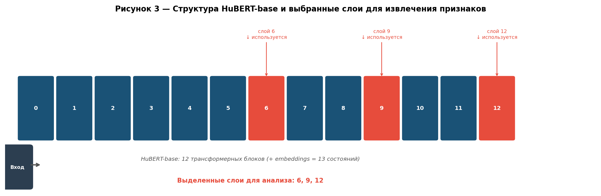
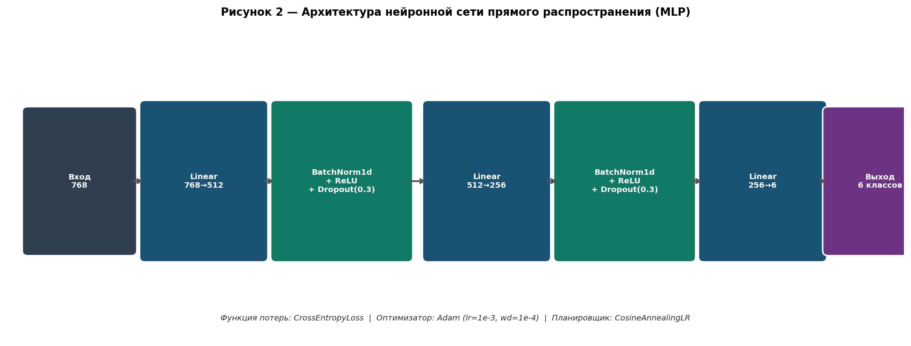

# Классификация акцента говорящего на основе признаков HuBERT

---

## 1 Описание выбранных методов

### 1.1 Метод извлечения признаков

В качестве метода извлечения признаков использовалась предобученная модель
**HuBERT-base** (facebook/hubert-base-ls960) [1] — самонаблюдаемая
(self-supervised) модель речи, обученная на датасете LibriSpeech (960 ч).
Модель представляет собой трансформерный энкодер с 12 слоями, принимающий
на вход сырой аудиосигнал с частотой дискретизации 16 кГц.

Для каждого аудиофайла из датасета L2-ARCTIC извлекались скрытые состояния
(hidden states) трёх слоёв модели: **6, 9 и 12**. Выбор нескольких слоёв
обусловлен тем, что нижние слои трансформера склонны кодировать
акустико-фонетические признаки (просодия, качество голоса), а верхние — более
абстрактные лингвистические единицы. Данное предположение проверялось в ходе
эксперимента.

Схема структуры модели и выбранных слоёв приведена на рисунке 3.

Поскольку длина аудиозаписей варьируется, для получения признакового вектора
фиксированной размерности применялось **усреднение по временному измерению**
(mean pooling):

```
h ∈ ℝ^(1 × T × 768)  →  x = mean(h, dim=T)  →  x ∈ ℝ^768
```

Извлечённые признаки сохранялись на диск в формате `.pt` (PyTorch tensor)
с метаданными (акцент, диктор, путь к файлу) для ускорения последующих
экспериментов. Общее число извлечённых образцов — **26 867** (по ~1 132
высказывания на каждого из 24 дикторов).

Общая схема конвейера обработки приведена на рисунке 1.

---

### 1.2 Классификатор — нейронная сеть прямого распространения (MLP)

В качестве **базового классификатора** (baseline) использовалась нейронная
сеть прямого распространения (Multi-Layer Perceptron, MLP).

**Архитектура сети** (рисунок 2):

| Слой | Тип | Параметры |
|---|---|---|
| Вход | — | 768 нейронов |
| Скрытый слой 1 | Linear + BatchNorm1d + ReLU + Dropout | 512 нейронов, p=0.3 |
| Скрытый слой 2 | Linear + BatchNorm1d + ReLU + Dropout | 256 нейронов, p=0.3 |
| Выход | Linear | 6 нейронов (число акцентов) |

**Гиперпараметры обучения:**

| Параметр | Значение |
|---|---|
| Функция потерь | CrossEntropyLoss |
| Оптимизатор | Adam |
| Скорость обучения (lr) | 1×10⁻³ |
| L2-регуляризация (weight decay) | 1×10⁻⁴ |
| Планировщик lr | CosineAnnealingLR |
| Размер батча | 256 |
| Максимальное число эпох | 150 |
| Ранняя остановка (patience) | 20 эпох |
| Нормализация признаков | StandardScaler (μ=0, σ=1) |

Обучение проводилось на GPU NVIDIA GeForce RTX 3070 Ti.

---

### 1.3 Сравниваемые методы классификации

Для объективного сравнения MLP-baseline оценивался совместно с пятью
классическими методами машинного обучения. Все методы обучались на одних и тех
же признаках (mean-pooled HuBERT hidden states) с предварительной нормализацией
через StandardScaler.

| Метод | Ключевые гиперпараметры |
|---|---|
| Логистическая регрессия (LogReg L2) | C=1.0, max_iter=1000, solver=lbfgs |
| Метод опорных векторов (SVM RBF) | C=10.0, kernel=rbf, gamma=scale |
| Случайный лес (Random Forest) | n_estimators=300, criterion=gini |
| Гистограммный градиентный бустинг (Hist-GBT) | max_iter=200, max_depth=6, lr=0.1 |
| Метод k ближайших соседей (KNN) | k=5, metric=euclidean |
| **Нейронная сеть (MLP)** | 768→512→256→6, см. раздел 1.2 |

---

## 2 Обоснование выбранного показателя точности

### 2.1 Используемые метрики

В качестве основных показателей качества классификации выбраны:

- **Accuracy (точность)** — доля верно классифицированных образцов;
- **F1-macro** — среднее арифметическое F1-меры по всем классам с одинаковым весом.

### 2.2 Обоснование выбора Accuracy

Датасет L2-ARCTIC содержит по 4 диктора на каждый из 6 акцентов, каждый диктор
записал ~1 132 высказывания из одного набора промптов (CMU Arctic). Итоговое
распределение образцов по классам:

| Акцент | Число образцов | Доля, % |
|---|---|---|
| Arabic | 4 365 | 16.2 |
| Mandarin | 4 524 | 16.8 |
| Hindi | 4 524 | 16.8 |
| Korean | 4 524 | 16.8 |
| Spanish | 4 402 | 16.4 |
| Vietnamese | 4 528 | 16.9 |

Классы **практически сбалансированы** (разброс менее 0.7 процентного пункта),
поэтому Accuracy является корректной и информативной метрикой и не завышает
показатели за счёт доминирования одного класса.

### 2.3 Обоснование использования F1-macro

F1-macro дополнительно включается для:
- контроля над возможным перекосом по классам при speaker-independent разбиении,
  где число образцов в тесте определяется одним диктором на класс;
- обеспечения совместимости с принятыми стандартами оценки в задачах
  распознавания акцента [2, 3], где F1-macro является основной отчётной метрикой.

При сбалансированных классах значения Accuracy и F1-macro совпадают до третьего
знака, что подтверждает корректность использования обеих метрик в данной задаче
(см. таблицы 1–2).

### 2.4 Протоколы оценки

В работе применялись два протокола разбиения данных:

**Протокол 1 — случайное разбиение (Random split).**
Высказывания случайно делятся на обучающую (70%), валидационную (10%) и
тестовую (20%) выборки. Разбиение стратифицировано по метке акцента.
*Недостаток:* одни и те же дикторы присутствуют во всех трёх выборках, что
приводит к **утечке идентичности говорящего** в тестовую выборку и завышенным
результатам (~99%).

**Протокол 2 — speaker-independent разбиение.**
Для каждого акцента один диктор (последний в алфавитном порядке кода) полностью
исключается из обучения и используется только в тестовой выборке. Таким образом,
тестовые дикторы *не встречаются* в обучении, что соответствует реальным условиям
применения системы.

| Акцент | Тестовый диктор |
|---|---|
| Arabic | ZHAA |
| Mandarin | TXHC |
| Hindi | TNI |
| Korean | YKWK |
| Spanish | NJS |
| Vietnamese | TLV |

Результаты по протоколу 1 приведены для воспроизведения известного эффекта
переобучения к диктору; результаты по протоколу 2 являются основными.

---

## 3 Таблица экспериментов

### 3.1 Протокол 1 — случайное разбиение (завышенные результаты)

> Таблица 1 — Результаты классификации акцента, случайное разбиение (train 70% / val 10% / test 20%)

| № | Метод | Слой HuBERT | Accuracy | F1-macro |
|---|---|---|---|---|
| 1 | LogReg (L2) | 6 | **0.9968** | **0.9968** |
| 2 | LogReg (L2) | 9 | 0.9808 | 0.9808 |
| 3 | LogReg (L2) | 12 | 0.9870 | 0.9869 |
| 4 | SVM (RBF) | 6 | 0.9981 | 0.9981 |
| 5 | SVM (RBF) | 9 | 0.9885 | 0.9884 |
| 6 | SVM (RBF) | 12 | 0.9944 | 0.9944 |
| 7 | Random Forest | 6 | 0.9790 | 0.9788 |
| 8 | Random Forest | 9 | 0.9118 | 0.9109 |
| 9 | Random Forest | 12 | 0.9378 | 0.9374 |
| 10 | Hist-GBT | 6 | 0.9933 | 0.9933 |
| 11 | Hist-GBT | 9 | 0.9630 | 0.9628 |
| 12 | Hist-GBT | 12 | 0.9810 | 0.9810 |
| 13 | KNN (k=5) | 6 | 0.9706 | 0.9706 |
| 14 | KNN (k=5) | 9 | 0.4721 | 0.4797 |
| 15 | KNN (k=5) | 12 | 0.8496 | 0.8506 |
| 16 | **MLP (512→256)** | 6 | **0.9996** | **0.9996** |
| 17 | **MLP (512→256)** | 9 | 0.9952 | 0.9952 |
| 18 | **MLP (512→256)** | 12 | 0.9957 | 0.9957 |

*Примечание.* Результаты завышены вследствие утечки идентичности диктора между
обучающей и тестовой выборками (подробнее — раздел 2.4 и таблица 3).

---

### 3.2 Протокол 2 — speaker-independent разбиение (корректная оценка)

> Таблица 2 — Результаты классификации акцента, speaker-independent разбиение (тест — 1 диктор на акцент)

| № | Метод | Слой HuBERT | Accuracy | F1-macro |
|---|---|---|---|---|
| 1 | **LogReg (L2)** | **6** | **0.4800** | **0.4585** |
| 2 | LogReg (L2) | 9 | 0.3641 | 0.3433 |
| 3 | LogReg (L2) | 12 | 0.3853 | 0.3517 |
| 4 | SVM (RBF) | 6 | 0.3618 | 0.3411 |
| 5 | SVM (RBF) | 9 | 0.3506 | 0.3372 |
| 6 | SVM (RBF) | 12 | 0.3441 | 0.3097 |
| 7 | Random Forest | 6 | 0.3575 | 0.3217 |
| 8 | Random Forest | 9 | 0.3329 | 0.3090 |
| 9 | Random Forest | 12 | 0.3406 | 0.2943 |
| 10 | Hist-GBT | 6 | 0.3968 | 0.3680 |
| 11 | Hist-GBT | 9 | 0.3089 | 0.2901 |
| 12 | Hist-GBT | 12 | 0.3497 | 0.3167 |
| 13 | KNN (k=5) | 6 | 0.3771 | 0.3691 |
| 14 | KNN (k=5) | 9 | 0.3603 | 0.3582 |
| 15 | KNN (k=5) | 12 | 0.3624 | 0.3533 |
| 16 | **MLP (512→256)** | 6 | 0.4316 | 0.3940 |
| 17 | **MLP (512→256)** | 9 | 0.3737 | 0.3530 |
| 18 | **MLP (512→256)** | 12 | 0.3921 | 0.3555 |

*Примечание.* Случайный базовый уровень (random baseline) для задачи 6 классов
равен 1/6 ≈ **0.167**. Все методы существенно превышают случайный выбор, что
свидетельствует о наличии акцентного сигнала в признаках HuBERT. Тем не менее
результаты значительно ниже, чем при случайном разбиении, что подтверждает вывод
об утечке идентичности диктора в протоколе 1.

---

### 3.3 Сравнение протоколов — деградация точности

> Таблица 3 — Разница в Accuracy между протоколами (Δ = Random − Speaker-independent) для слоя 6

| Метод | Random split | Speaker-indep. | Δ Accuracy |
|---|---|---|---|
| LogReg (L2) | 0.9968 | 0.4800 | −0.517 |
| SVM (RBF) | 0.9981 | 0.3618 | −0.636 |
| Random Forest | 0.9790 | 0.3575 | −0.622 |
| Hist-GBT | 0.9933 | 0.3968 | −0.597 |
| KNN (k=5) | 0.9706 | 0.3771 | −0.593 |
| **MLP (512→256)** | **0.9996** | 0.4316 | **−0.568** |

*Падение точности в среднем на 0.59 (−59 п.п.) при переходе к честному протоколу
подтверждает, что модели в протоколе 1 решали задачу идентификации диктора,
а не классификации акцента.*

---

## 4 Рисунки архитектур

### 4.1 Схема конвейера обработки



**Рисунок 1** — Схема конвейера классификации акцента говорящего.
Входной аудиофайл (.wav, 16 кГц) подаётся в предобученную модель HuBERT-base.
Из выбранного слоя (6, 9 или 12) извлекаются скрытые состояния размерности
(T × 768), которые усредняются по временному измерению (mean pooling) в вектор
признаков (768,). Вектор поступает в классификатор, который выдаёт одну из
6 меток акцента.

---

### 4.2 Структура HuBERT-base и выбранные слои



**Рисунок 3** — Структура модели HuBERT-base (12 трансформерных блоков +
embeddings). Красным выделены слои 6, 9 и 12, скрытые состояния которых
использовались в качестве признаков. Слой 6 соответствует средним
представлениям, несущим акустико-фонетическую информацию; слой 12 —
верхним представлениям, более специализированным на лингвистическом содержании.

---

### 4.3 Архитектура нейронной сети прямого распространения (MLP)



**Рисунок 2** — Архитектура нейронной сети прямого распространения.
Входной вектор признаков размерности 768 проходит через два скрытых слоя
(512 и 256 нейронов соответственно). Каждый скрытый слой включает:
линейное преобразование (Linear), пакетную нормализацию (BatchNorm1d),
функцию активации ReLU и слой регуляризации Dropout (p=0.3).
Выходной слой — линейный (256→6) без функции активации; вероятности
вычисляются неявно через CrossEntropyLoss при обучении и Softmax при инференсе.

---

## 5 Анализ результатов

### 5.1 Влияние слоя HuBERT на качество классификации

Слой 6 стабильно превосходит слои 9 и 12 во **всех** методах и протоколах
оценки. Это объясняется тем, что нижние слои HuBERT кодируют
акустико-фонетические свойства речи (которые напрямую связаны с акцентом),
тогда как верхние слои специализируются на лингвистическом содержании
(семантика, синтаксис), инвариантном к акценту.

### 5.2 Выбор лучшего метода

При **корректном** (speaker-independent) протоколе лучшим методом оказывается
**логистическая регрессия** (Accuracy=0.48, слой 6), незначительно опережая MLP
(Accuracy=0.43). Это объясняется:
- малым числом обучающих дикторов (3 диктора на класс ≈ 3 396 обучающих образцов
  на акцент), при котором простые линейные модели обобщают лучше;
- склонностью MLP к запоминанию особенностей конкретных дикторов из обучающей
  выборки при отсутствии достаточной вариативности.

### 5.3 Аномальное поведение KNN на слое 9

Метод KNN показывает резкое падение точности на слое 9 до Accuracy=0.47 при
случайном разбиении (и 0.36 при speaker-independent). Это свидетельствует о том,
что геометрия признакового пространства на слое 9 разрушает локальную соседскую
структуру: кластеры дикторов на этом слое значительно менее компактны, чем на
слоях 6 и 12 (подтверждается анализом кластеризации: Silhouette_speaker=0.020
на слое 9 против 0.064 на слое 6).

### 5.4 Вывод о разделимости данных

Несмотря на статистически значимое превышение случайного уровня (0.167),
результаты speaker-independent классификации (0.31–0.48) указывают на то, что
признаки HuBERT **не обеспечивают достаточной разделимости акцентов** при
переносе на новых дикторов. Акцентный сигнал присутствует в представлениях, но
**перемешан** с индивидуальными характеристиками голоса. Это является основной
мотивацией для применения разреженных автоэнкодеров (SAE) с целью факторизации
признакового пространства.

---

## Список использованных источников

[1] Hsu, W.-N., Bolte, B., Tsai, Y.-H. H., Lakhotia, K., Salakhutdinov, R.,
& Mohamed, A. (2021). HuBERT: Self-supervised speech representation learning by
masked prediction of hidden units. *IEEE/ACM Transactions on Audio, Speech, and
Language Processing*, 29, 3451–3460.

[2] Sheng, L., & Wakabayashi, K. (2022). Comparison of methods for non-native
English accent recognition. *IEICE Transactions on Information and Systems*,
E105-D(3), 613–622.

[3] Shi, X., Liu, F., & Xu, H. (2021). Accents in the Wild: Integrating accent
information into end-to-end speech recognition. *Proc. Interspeech 2021*, 3886–3890.
