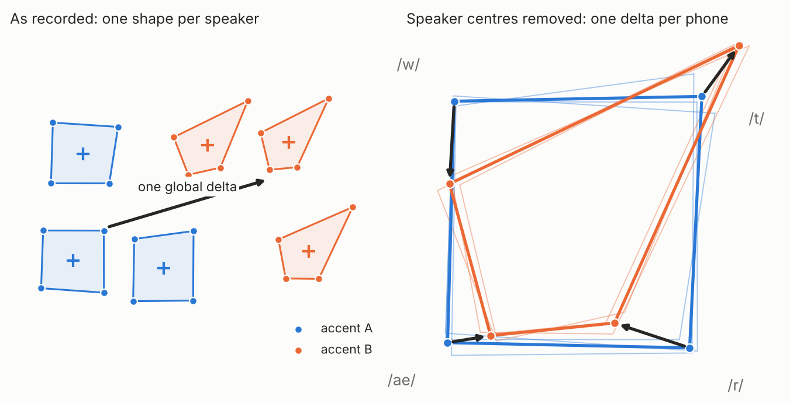
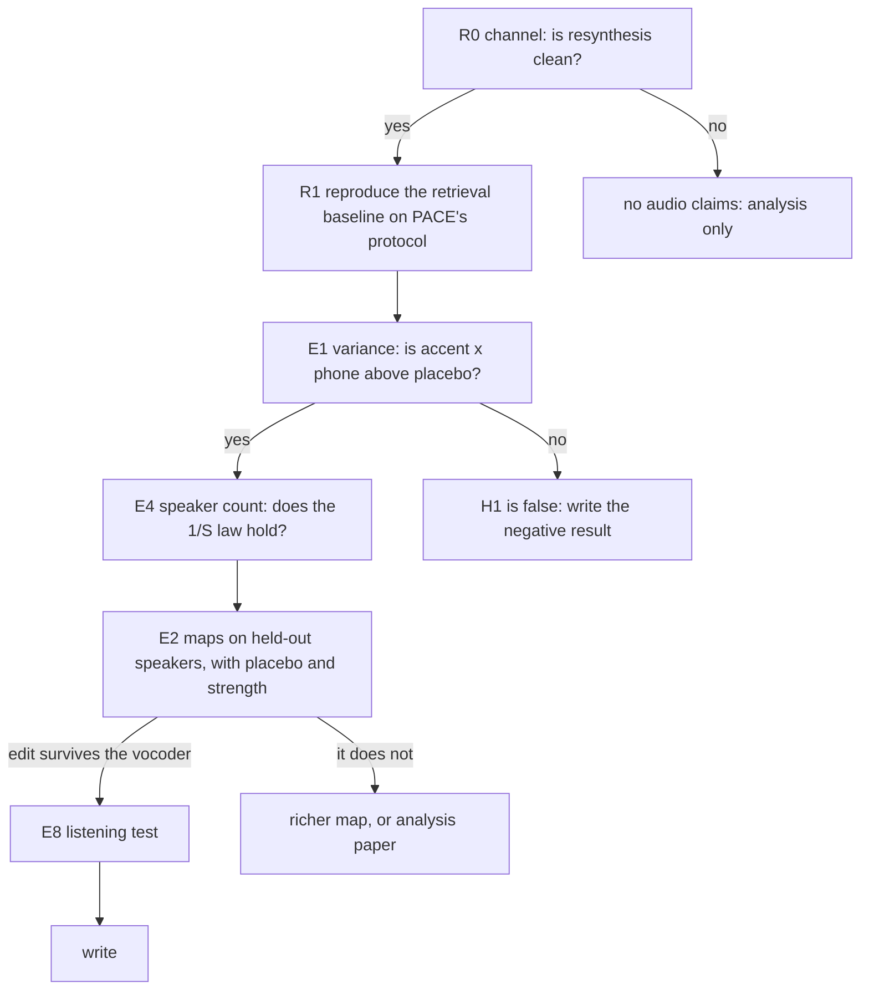

# Accent Is a Conditional

Working repository for a paper on accent transfer by editing frozen speech
representations. Target: Interspeech 2027.

> [!IMPORTANT]
> **Status, 12 Nov 2026. Nothing here has been measured on accented speech.**
> The code exists and its estimators are tested, the channel has been run on a
> single clip of real speech, and that is all. Every statement below about
> accent is a hypothesis with the experiment that will test it. No number from
> earlier pilots or from AccentFlow is used as evidence; they are the source of
> the ideas only.

**Contents:** [1 Question](#1-question) ·
[2 Where the field is](#2-where-the-field-is) ·
[3 Model](#3-model) ·
[4 Measurement](#4-measurement) ·
[5 Experiments, in order](#5-experiments-in-order) ·
[6 Protocol](#6-protocol) ·
[7 Code](#7-code) ·
[8 What is verified](#8-what-is-verified) ·
[9 Threats to validity](#9-threats-to-validity) ·
[10 Timeline](#10-timeline) ·
[References](REFERENCES.md)

---

## 1. Question

Editing a frozen speech representation can move an utterance towards a target
accent. Every published version of this pays for it in speaker identity: the
more accent, the less the voice is the same person. We ask two things.

1. **Why do accent evidence and voice loss rise together?** Is it a property
   of accent, of the maps used, or of how accent is measured?
2. **Is there an edit that moves the accent and provably leaves the voice
   where it was,** and does a listener hear it?

**In plain words.** An accent is not "everything sounds a bit different". It
is "particular sounds are pronounced differently". If that is right, an edit
should act on each sound separately, relative to the speaker's own average,
and anything that moves all frames together, or replaces frames by somebody
else's, moves the speaker.

<p align="center"><br>
<em>Schematic of the idea, drawn, not measured. Left: two accent groups differ mostly by who is in them. Right: with each speaker's centre removed, the accent would be a different displacement for each phone.</em></p>

---

## 2. Where the field is

Read status and links for everything below are in [REFERENCES.md](REFERENCES.md).

| Work | What it does | What it leaves open for us |
|---|---|---|
| **PACE** (Qu et al., Sep 2026) | Accent conversion by editing frozen WavLM-Large layer-6 frames and vocoding with the kNN-VC backend, on L2-ARCTIC. Accent directions from a frame-level PLS fit against accent labels; frames moved by entropic transport, then fused with retrieved target-accent frames. | No phonetic conditioning, no per-speaker centring. Accent is scored by one classifier fine-tuned on L2-ARCTIC; no listening test. The authors report that accent accuracy rises as speaker similarity falls and name "stronger source-preserving edits" and listening tests as future work. Code is not released (the repository holds a README only). |
| **StateVC** (Qu et al., Oct 2026) | Training-free voice conversion by state-wise mean shifts in WavLM space, with posterior-weighted updates and a strength parameter. States come from a GMM fitted to one source–reference pair. Code released. | The same class of map as ours (a translation per content cell). It is used to *change* the voice from one utterance pair; we use it to change accent while *keeping* the voice, with cells given by the transcript and statistics pooled over speakers. |
| **Phoneme-aware accent identification** (Qu et al., Sep 2026) | Speaker-disjoint L1 identification from phoneme-aligned units instead of one utterance embedding. | Establishes for *identification* that accent cues are phoneme-dependent. It does not quantify how much of the representation they occupy, nor edit them. |
| **kNN-VC** (Baas et al., 2023) | Voice conversion by replacing each frame with the mean of its nearest target frames; provides the encoder and vocoder we use. | The barycentric map in its purest form. |
| **MKL-VC** (Lobashev et al., 2025) | Voice conversion by a factorised Gaussian transport map in WavLM space. | The affine row of our family of maps, for voice. |
| **Liu, Tang, Goldwater** (2023) | Speaker and phone variance lie in nearly orthogonal subspaces, for APC and CPC models. | Motivation for an additive speaker term. Not shown for WavLM, and silent on accent and on interactions. |

**What is left to show.** That the trade-off has an explanation, that the
explanation predicts which edit avoids it, and that listeners agree. The idea
that accent is segmental is not new, and neither is a per-cell translation.
The combination below, with the analysis and the evaluation, is what we have
not found in print. The same group that wrote PACE is the most likely to
publish it first.

**Hypotheses.**

- **H1.** In frozen WavLM frames, accent appears as an *accent × phone*
  interaction that is above its placebo level, and it is estimable from few
  speakers, while a global accent direction is not.
- **H2.** A per-phone translation of speaker-centred frames moves accent
  evidence on speakers it was not fitted on, and a barycentric (retrieval) map
  moves it together with the voice.
- **H3.** At matched accent evidence, the translation preserves speaker
  identity better than retrieval-based editing, by automatic metrics and by
  listeners.

---

## 3. Model

### 3.1 Notation

A frozen encoder maps a waveform to frames $x_1,\dots,x_T\in\mathbb{R}^d$
(WavLM-Large, layer 6, $d=1024$, one frame per 20 ms). Each frame has

- a content label $c\in\{1,\dots,K\}$: the phone it *should* realise, from the
  transcript by forced alignment ($K=39$);
- a speaker $s$;
- an accent $a(s)$. Speakers are nested in accents: nobody has two.

Content is canonical on purpose. A cluster index computed from the frames is
already accented: a retroflex /t/ may fall in another cluster than an alveolar
one, and conditioning on it would hide the difference we want to move.

### 3.2 Decomposition

```math
x \;=\; \mu_c \;+\; u_s \;+\; v_{a(s),c} \;+\; w_{s,c} \;+\; \varepsilon ,
\qquad \mathbb{E}[\varepsilon \mid c,s]=0
```

| Term | Meaning | Constraint |
|---|---|---|
| $`\mu_c`$ | the sound: mean frame of phone $c$ | |
| $`u_s`$ | the voice: offset of speaker $s$, the same for every phone. It contains any global accent offset $`m_a=\mathbb{E}[u_s\mid a]`$ | |
| $`v_{a,c}`$ | how accent $a$ bends phone $c$ | $`\sum_c p_c\,v_{a,c}=0`$ |
| $`w_{s,c}`$ | how speaker $s$ personally bends phone $c$ | $`\sum_c p_c\,w_{s,c}=0`$, $`\mathbb{E}[w_{s,c}\mid a]=0`$ |
| $`\varepsilon`$ | everything else: context, position in the phone, prosody, noise | |

$p_c$ is a fixed reference distribution over phones.

**This is not an assumption about the data.** Take the table of mean frames
per (speaker, phone). Any such table splits uniquely into a column effect, a
row effect and an interaction, given the constraints: a two-way layout with
speakers nested in accents. The constraints make the interaction terms sum to
zero over phones, so an edit along $v$ cannot move a speaker's centre. The
real assumptions are listed in 3.8.

### 3.3 Statistics

With $`\bar x_{s,c}`$ the mean frame of speaker $s$ on phone $c$:

```math
\bar x_s=\sum_c p_c\,\bar x_{s,c}\quad\text{(speaker centre)},
\qquad
r_{s,c}=\bar x_{s,c}-\bar x_s\quad\text{(profile)}
```

For source accent $a$ and target accent $b$ with $S$ reference speakers each:

```math
\hat\delta=\frac1S\sum_{s\in b}\bar x_s-\frac1S\sum_{s\in a}\bar x_s
\qquad\qquad
\hat\Delta_c=\frac1S\sum_{s\in b}r_{s,c}-\frac1S\sum_{s\in a}r_{s,c}
```

$\hat\delta$ (one vector) estimates $m_b-m_a$. $`\hat\Delta_c`$ (one vector
per phone) estimates $`\Delta_c=v_{b,c}-v_{a,c}`$.

### 3.4 What finitely many speakers identify

**Proposition 1.** With $S$ speakers per accent drawn independently and many
frames per cell,

```math
\mathbb{E}\,\lVert\hat\delta-(m_b-m_a)\rVert^2=\frac{2}{S}\,\mathrm{tr}\,\Sigma_u ,
\qquad
\mathbb{E}\,\lVert\hat\Delta_c-\Delta_c\rVert^2=\frac{2}{S}\,\mathrm{tr}\,\Sigma_{w,c}
```

where $`\Sigma_u=\mathrm{Cov}(u_s\mid a)`$ and
$`\Sigma_{w,c}=\mathrm{Cov}(w_{s,c}\mid a)`$. Moreover $`\hat\Delta_c`$ is
unchanged by any per-speaker translation $x\mapsto x+t_s$.

*Why.* $`\bar x_s=\bar\mu+u_s`$ up to noise, so $\hat\delta$ is a difference
of two averages of $S$ speaker offsets. In $`r_{s,c}`$ the offset $u_s$ has
cancelled, and so would any $t_s$; what remains is
$`(\mu_c-\bar\mu)+v_{a,c}+w_{s,c}`$, and the difference of two accent averages
leaves $\Delta_c$ plus two averages of $S$ personal terms.

*Reading.* The global direction is as noisy as speakers are different. The
conditional direction pays only for how speakers personally realise each
phone. Whether $`\mathrm{tr}\,\Sigma_w`$ is small enough at $S=3$ is an
empirical question (E1, E4). And whether $m_a$ is "accent" or "the average
voice of the people recorded" cannot be decided from the data at all, so the
editor keeps the two apart.

### 3.5 Transfer as conditional transport

Let $`\mu_{a\mid c}`$ be the law of speaker-centred frames of accent $a$ on
phone $c$. Moving accent without moving content is

```math
T^\star=\arg\min_T\;\mathbb{E}\,\lVert x-T(x,c)\rVert^2
\quad\text{s.t.}\quad T(\cdot,c)_\#\,\mu_{a\mid c}=\mu_{b\mid c}\ \ \forall c
```

which is optimal transport with a cost that forbids changing the phone. For
Gaussian conditionals the solution is closed-form,
$`T^\star(x,c)=m_{b,c}+A_c(x-m_{a,c})`$ with $A_c$ the Bures–Wasserstein
matrix. Restricting the cells and the map class gives a family in which
published methods are points:

| Cells | Map on each cell | Name in `e2_maps.py` | Closest published form | Parameters |
|---|---|---|---|---|
| 1 | translation | `global shift` | delta vectors, activation steering | $d$ |
| 1 | diagonal affine | `global affine` | — | $2d$ |
| 1 | barycentric | `global barycentre` | kNN-VC; the retrieval stage of PACE | none |
| a few GMM states per pair | translation | — | StateVC (for voice) | per pair |
| 39 phones | translation, speaker-centred | **`conditional shift`** | — | $39\,d$ |
| 39 phones | diagonal affine | `conditional affine` | per-cell Gaussian maps (MKL-VC is the full-covariance, global case) | $78\,d$ |
| 39 phones | barycentric | `conditional barycentre` | — | none |
| same accent on both sides | translation | `placebo` | — | speaker leak only |

Parameters grow downwards within a block, and so does the number of speakers
needed to estimate them. PACE's first stage, a transport-weighted shift inside
a global PLS subspace, is not in `e2_maps.py` yet (see R1).

### 3.6 What a map does to the speaker

**Proposition 3.** Let $`x=\mu_c+u_s+v_{a,c}+w_{s,c}+\varepsilon`$.

1. *Translation.* $`T(x)=x+\Delta_c=\mu_c+u_s+v_{b,c}+w_{s,c}+\varepsilon`$.
   The same speaker, the same personal terms, accent $b$.
2. *Barycentre.* For any coupling $\pi$ of source and target frames,
   $`T(x)=\mathbb{E}_\pi[Y\mid X=x]`$ equals
   $`\mu_c+v_{b,c}+\mathbb{E}_\pi[u_{s'}+w_{s',c}+\varepsilon'\mid x]`$: the
   speaker terms become convex combinations of those of the *target*
   speakers. Also $`\mathrm{Cov}\,T(X)\preceq\mathrm{Cov}\,Y`$, by the law of
   total variance.

*Reading.* A translation moves the accent and carries the voice with it. A
barycentre fetches the accent together with somebody else's voice. Centring
the frames before a barycentric map removes $`u_{s'}`$ but not $`w_{s',c}`$.
If H2 holds, this is the mechanism behind the trade-off reported for
retrieval-based editing.

*Residual leak of a translation.* $`\hat\Delta_c`$ is an average over
reference speakers, so by Proposition 1 it carries their personal terms with
variance $`\tfrac2S\,\mathrm{tr}\,\Sigma_{w,c}`$. Prediction: the identity
cost of the conditional shift falls as $1/S$. The `placebo` map measures it
directly.

(The numbering follows the paper draft, where Proposition 2 is the statement
that the rows of the table in 3.5 solve one problem under nested restrictions.)

### 3.7 The editor

```math
T_{\lambda,\kappa}(x,c)=x+\lambda\,\Delta_c+\kappa\,\delta
```

$\lambda$ is segmental strength and leaves the speaker centre untouched;
$\kappa$ is global strength (frame-level AccentFlow). For an optimal map
$T^\star$, $`(1-\lambda)\,\mathrm{id}+\lambda T^\star`$ is displacement
interpolation, so strength is a position on a transport geodesic. Silence is
never edited.

### 3.8 Assumptions that can fail

- **Accent changes the mean of a phone, not the shape of its distribution.**
  If it changes the shape, a shift is not enough (compare `conditional affine`).
- **Everything inside a phone is averaged.** Context and position go into
  $\varepsilon$. Accent that lives in transitions between sounds is lost.
- **Speakers are an independent sample.** The $1/S$ law depends on it.
- **The label is the intended phone,** not the one produced. A substitution
  that crosses phone categories is only partly a shift within the category.
- **The vocoder responds to shifted frames.** They are off the manifold it
  was trained on.

---

## 4. Measurement

### 4.1 Variance components

Split each speaker's utterances in two halves. For centres and for
$p$-weighted profiles, average three kinds of inner product:

- **self**: the same speaker, half against half;
- **same**: two different speakers of one accent;
- **diff**: two speakers of different accents.

Different speakers and different halves have independent noise, and any term
common to everybody cancels in a difference. Hence, without bias under a
random-effects reading of the model:

| Component | Estimator |
|---|---|
| content | diff (profiles) |
| speaker | self − same (centres) |
| accent, global | same − diff (centres) |
| speaker × phone | self − same (profiles) |
| **accent × phone** | **same − diff (profiles)** |
| residual | $`\mathbb{E}\lVert x\rVert^2`$ − self (centres) − self (profiles) |

`variance.components`. Shares are relative to the total.

### 4.2 Placebo and spread

- **Placebo:** shuffle accent labels across speakers and recompute. The
  accent terms must fall to a band around zero (`variance.permutation_null`).
- **Leave one speaker out:** with four speakers per accent no confidence
  interval deserves the name; the range of each component when each speaker
  is removed shows how much it hangs on one person
  (`variance.leave_one_speaker_out`).

### 4.3 Error of a direction

Estimate a delta twice, from disjoint sets of $S$ speakers. Half the squared
distance between the two is the error of one estimate; their inner product is
the squared norm of the true delta (`variance.delta_error`). Proposition 1
predicts the error from the components of 4.1, with nothing fitted.

### 4.4 Accent and identity from frames

All computed on frames re-encoded from the vocoded audio, so an edit must
survive resynthesis to count.

| Quantity | Definition | What it cannot show |
|---|---|---|
| `accent` | cosine between the edited speaker's profile and the target accent's mean profile, both relative to the mean over accents | lives in the space we edit; not a listener |
| `accent_hit` | 1 if the target accent is the nearest | same |
| `centre_shift` | displacement of the content-balanced centre, in typical distances between speakers | sees only the global part of the voice |
| `profile_kept` | cosine between the personal profile after and before, with the span of accent profiles projected out | accent subspace is estimated from few speakers |

An utterance-level mean cannot see a conditional edit at all, because
$`\sum_c p_c\,\Delta_c=0`$. Any accent metric built on utterance means is
blind to it by construction.

### 4.5 From audio

Word error rate with Whisper; speaker cosine to the original recording with
Resemblyzer (the "SECS" of PACE) and with ECAPA-TDNN. All differences are
taken to identity resynthesis through the same channel, not to the original.

### 4.6 Not yet in the code

- An accent metric in an **independent** encoder, speaker-disjoint.
- The classifier PACE uses, to report on their scale.
- A listening test. No automatic number replaces it.

---

## 5. Experiments, in order

Each step has a pass condition. Nothing later is interpretable if an earlier
gate fails.



### R0. Channel gate (`e0_channel.py`)

*Question.* Does WavLM → HiFi-GAN resynthesis, with nothing edited, keep the
words and the voice of L2-ARCTIC speakers?
*Pass.* WER and speaker cosines close to the original for both public
vocoders, and `results/e0_audio/` does not sound robotic.

### R1. Reproduce the baseline

*Question.* Do we recover published numbers on the published protocol?
*Method.* `global barycentre` at strength 0.7 and 1.0 is, as far as the paper
describes it, PACE's "original WavLM retrieval" and "reference replacement".
Run it on accent → accent pairs of L2-ARCTIC and score with their metrics.
*Pass.* Speaker similarity and WER in the neighbourhood of their table.
*Open.* Their accent classifier has to be located; their first stage (PLS
subspace and unbalanced transport) has to be reimplemented from the paper, and
the subspace dimension is not stated there.

### E1. Where accent lives, with the placebo (`e1_variance.py`)

*Question.* Is there an accent × phone component, at which layers, how large?
*Method.* 4.1 and 4.2, for layers 3, 6, 9, 12, 18, 24, on the six L2 accents.
Also leave-one-speaker-out accent identification from the profile and from
the centre.
*Supports H1 if* accent × phone lies above its placebo band and the profile
identifies accent better than the centre.
*Refutes H1 if* it is inside the band at every layer.

### E4. How many speakers (`e4_speaker_count.py`)

*Question.* Is the conditional direction above its own noise at $S\le 3$?
*Method.* 4.3. L2-ARCTIC allows $S=1,2$ only.
*Supports H1 if* measured errors match $2/S$ times the components of E1 and
the conditional error is below its signal while the global one is not.
*Limit.* The curve beyond $S=2$ stays a prediction until a corpus with more
speakers per accent is used.

### E2. Every map on held-out speakers (`e2_maps.py`)

*Question.* H2 and H3.
*Method.* Section 6. The `placebo` system is E3 in audio; several strengths
give E6.
*Supports H2 if* `conditional shift` raises accent evidence above `placebo`
after the vocoder, and barycentres raise it with a larger `centre_shift` and a
lower `profile_kept`.
*Supports H3 if* at matched accent evidence the translation has the higher
speaker cosine.
*Refutes H2 if* the shift is indistinguishable from the placebo at every
strength.

### E8. Listening test

*Question.* Do listeners hear the target accent and the same voice?
*Method.* The protocol and web form in `accent_l2/docs/HUMAN_EVAL_PROTOCOL.md`,
with systems original, identity, `conditional shift`, the retrieval baseline.
*This is the only evidence for the word "transfer".*

### Later, if time allows

E5: k-means units against canonical phones. E7: phone durations by
one-dimensional transport ([spec](docs/E7_durations.md)). Native → accented
direction with a second corpus, for the translation cascade.

---

## 6. Protocol

- **Data.** L2-ARCTIC: 24 speakers, six first languages, four speakers each,
  the same prompts for everyone, phone alignments shipped with the corpus.
- **Folds.** Fold $f$ holds out the $f$-th speaker (sorted by name) of every
  accent; four folds. A held-out speaker enters no statistic, no reference
  profile and no retrieval pool.
- **Utterances.** The same sentences are held out as test utterances for
  every speaker and enter no statistic.
- **Pairs.** Accent → accent, all 30 ordered pairs by default, as in PACE.
- **Baseline for every number.** Identity resynthesis through the same
  channel.
- **Second corpus.** CMU ARCTIC can be added as an accent `native`. It is off
  by default: it was recorded elsewhere and labelled by another aligner, and a
  systematic difference in boundaries would look like an accent × phone effect
  that the placebo cannot catch.

---

## 7. Code

```
otaccent/
  corpus.py      L2-ARCTIC (and optionally CMU ARCTIC): speakers, accents, alignments
  features.py    the channel: WavLM-Large layer 6 <-> HiFi-GAN (kNN-VC checkpoints)
  stats.py       Table of sufficient statistics; centres, profiles, the two deltas
  maps.py        editors: shift, diagonal Gaussian map, barycentre
  variance.py    components, placebo, leave-one-speaker-out, error of a delta
  metrics.py     accent from the phone profile; WER; speaker cosines
  synthetic.py   a world that obeys the model with known components (for tests)
experiments/     extract.py, e0_channel.py, e1_variance.py, e4_speaker_count.py, e2_maps.py,
                 overview_figures.py (summary figures from the result files; also draws the schematic)
tests/           the propositions as unit tests
config.yaml      paths and the few numbers that matter
```

Everything in E1 and E4, and every fitted map, is a function of one table:
the sum and sum of squares of frames per (speaker, half, phone).
`extract.py` fills it once on a GPU; the rest runs on a laptop.

```python
from otaccent import maps
from otaccent.stats import conditional_delta, global_delta

p, m = tab.content(), tab.means()                  # p_c and the (speakers, 39, 1024) phone means
src, tgt = tab.idx("hindi", exclude=held), tab.idx("korean", exclude=held)
Delta = conditional_delta(m, p, src, tgt)          # (39, 1024)
delta = global_delta(m, p, src, tgt)               # (1024,)
Y = maps.shift(X, c, Delta, delta, lam=1.0, kappa=0.0)    # X: (T, 1024) frames, c: (T,) phone ids
wav = vocoder(Y)
```

### Run

```bash
pip install -r requirements.txt
# config.yaml: set l2_arctic; point cache/ at persistent storage
python -m pytest -q                      # estimators against a world with known truth
python -m experiments.extract            # once, GPU, resumable
python -m experiments.e0_channel         # then listen to results/e0_audio
python -m experiments.e1_variance
python -m experiments.e4_speaker_count
python -m experiments.e2_maps            # resumable
```

Result tables and figures in `results/` are committed; audio is not.

Every script also takes `--synthetic`, which replaces the corpus by
`otaccent.synthetic.World`. That is a test of the code against known truth.
Its output is not a result and must not be reported as one.

---

## 8. What is verified

| Verified | How |
|---|---|
| Estimators recover known components; accent terms vanish under the placebo; $`\hat\Delta_c`$ is invariant to speaker translations; the error of a delta equals $2/S$ times the variance; a translation keeps centre and personal profile, a barycentre replaces them; editors are the identity at zero strength and spare silence | `python -m pytest`, 9 tests on a synthetic world |
| `Encoder` returns exactly the frames of the kNN-VC fast path; both vocoders produce audio | one clip of real speech, CPU |
| Resemblyzer wrapper | same clip: cosine between the original and its resynthesis 0.96 (plain vocoder) and 0.91 (prematched vocoder). One clip of one unknown speaker, not L2-ARCTIC |
| `extract → e1 → e4 → e2` runs end to end with the real encoder and vocoder | a fabricated mini-corpus in the L2-ARCTIC layout: real audio, invented alignments |

| Not verified | Consequence |
|---|---|
| The loader on the real L2-ARCTIC `textgrid/` files | if `extract.py` finds nothing, look at `corpus.py` |
| `metrics.Asr` and `metrics.Ecapa` | never run; `accent_l2/src/resynth/audio_metrics.py` has tested equivalents |
| Every statement about accent | that is what the experiments are for |

---

## 9. Threats to validity

- **Four speakers per accent.** Accent and speaker are barely separable at
  this size. E1 reports the leave-one-speaker-out range; E4 says how far the
  estimates can be trusted; neither makes the sample larger.
- **The accent score lives in the edited space.** It shows that an edit
  survives the vocoder, not that it is accent to a listener or to another
  model. An independent speaker-disjoint metric and E8 are required.
- **Classifier-based accent evidence can be voice evidence.** A classifier
  trained on the same speakers it is tested on may respond to the voice. This
  applies to published numbers and would apply to ours.
- **Alignment quality on accented speech.** Boundaries from a forced aligner
  are less reliable for L2 speech; errors blur the profiles.
- **Read speech, one sentence set.** Nothing here says anything about
  spontaneous speech or other content.
- **Priority.** The nearest group has the same channel, the same data, a
  released per-state shift for voice conversion and a phoneme-aware accent
  model, and names our direction as future work.

---

## 10. Timeline

Paper deadline: 9 February 2027 according to a tracker that reads the
conference's dates page. To be confirmed on the official site.

| Weeks | Work | Gate |
|---|---|---|
| 1 (to 18 Nov) | Read PACE, StateVC, the phoneme-aware identification paper and MKL-VC in full. `extract.py` and R0 on L2-ARCTIC. | resynthesis is clean |
| 2–3 (to 2 Dec) | R1. E1 and E4. | accent × phone above placebo, or stop |
| 4–5 (to 16 Dec) | E2 on all pairs; independent accent metric; listen ourselves. | the shift beats the placebo after the vocoder |
| 6–7 (to 30 Dec) | Fix what fails; ablations; freeze systems; prepare E8. | systems frozen |
| 8–9 (to 13 Jan) | E8: pilot, then full. | listener data in |
| 10–12 (to 8 Feb) | Write, internal review, demo page, submit. | |

Introduction, related work and section 3 can be written from week 1.
