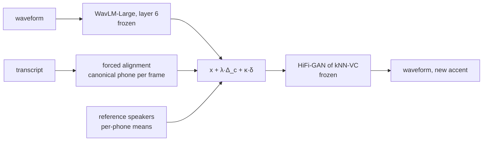
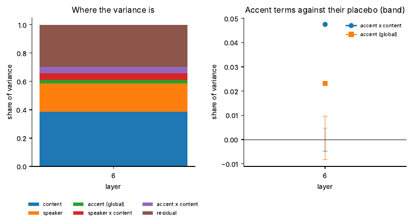
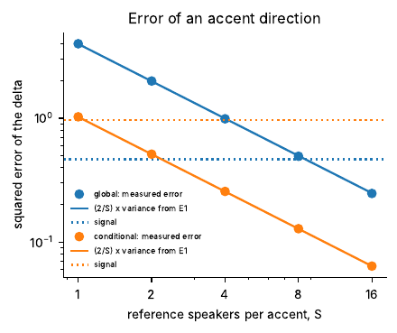
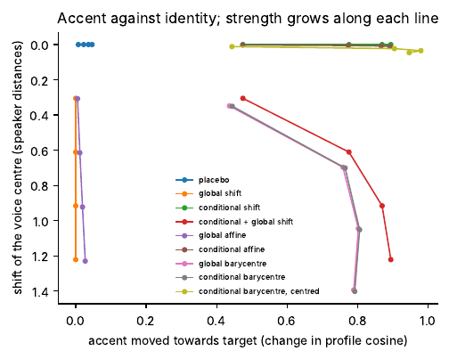
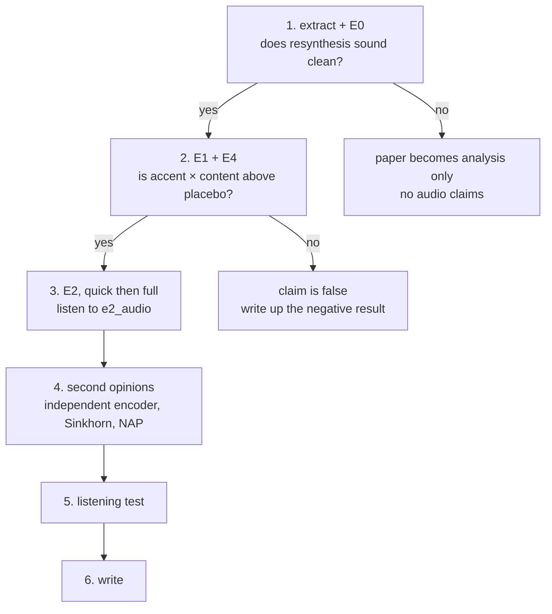

# Accent Is a Conditional

Experiments for the paper *"Accent Is a Conditional: Content-Conditional Optimal
Transport for Accent Transfer in Frozen Speech Representations"*
(target: Interspeech 2027).

> [!IMPORTANT]
> **Status, 11 Nov 2026.** The code runs and its mathematics is tested on a
> synthetic world. **No real accented speech has been through it yet.** Every
> figure on this page is synthetic and shows the *shape* of a result, not a
> result. The first real run is step 1 of [Next steps](#7-next-steps).

**Contents:** [1 The idea](#1-the-idea) ·
[2 Three claims](#2-three-claims-three-experiments) ·
[3 What changes from `accent_l2`](#3-what-changes-from-accent_l2) ·
[4 The family of maps](#4-the-family-of-maps) ·
[5 Code](#5-code) ·
[6 Experiments](#6-experiments) ·
[7 Next steps](#7-next-steps) ·
[8 Decisions for the call](#8-decisions-for-the-call) ·
[9 What is checked](#9-what-is-checked-and-what-is-not)

---

## 1. The idea

A Hindi accent is not "more of something" in every frame. It is a different
/t/, a different /w/, a different vowel in *cat*. So accent is a property of
how **each sound** is realised, and moving it means moving each sound
separately. Anything that moves all frames together mostly moves the speaker.

We write one frame of speaker $s$ saying phone $c$ as

```math
x \;=\; \underbrace{\mu_c}_{\text{the sound}}
 \;+\; \underbrace{u_s}_{\text{the voice}}
 \;+\; \underbrace{v_{a(s),c}}_{\text{accent bends the sound}}
 \;+\; \underbrace{w_{s,c}}_{\text{this speaker bends the sound}}
 \;+\; \varepsilon
```

and the editor is a translation with two knobs:

```math
T_{\lambda,\kappa}(x, c) \;=\; x \;+\; \lambda\,\Delta_c \;+\; \kappa\,\delta
```

| Symbol | What it is | How it is estimated |
|---|---|---|
| $`\Delta_c`$ | conditional delta: how the target accent bends phone $c$ relative to the source accent | difference of **speaker-centred** phone means, averaged over reference speakers |
| $\delta$ | global delta: difference of the mean voices of the two groups | difference of speaker centres (this is AccentFlow at frame level) |
| $\lambda$ | segmental strength | leaves the speaker's centre exactly where it was |
| $\kappa$ | global strength | moves the voice centre; cannot be told apart from "the average voice of the people we recorded" |

The whole pipeline, with nothing trained:



---

## 2. Three claims, three experiments

| | Claim | In the paper | Experiment | Refuted if |
|---|---|---|---|---|
| **1** | Accent lives in the **accent × content** term. The global accent term cannot be separated from the speaker with 4 speakers per accent. | Proposition 1 | [E1](#e1--where-accent-lives-with-the-placebo-of-e3), [E4](#e4--how-many-speakers-does-a-direction-need) | accent × content is inside its placebo band at every layer |
| **2** | Delta vectors, per-unit steering, Gaussian maps and retrieval are **one conditional transport problem** with different restrictions. | Proposition 2 | [E2](#e2--every-map-on-held-out-speakers) compares them on one protocol | conditional maps are no better than global ones on held-out speakers |
| **3** | **Translations carry the voice; barycentres replace it.** That is why retrieval editors lose identity as accent grows. | Proposition 3 | [E2](#e2--every-map-on-held-out-speakers), identity columns | barycentres keep identity as well as translations at equal accent |

---

## 3. What changes from `accent_l2`

The pilot in `accent_l2/` already found the pattern the paper explains:
unit-conditional mean shift moved accent-ID by +0.19 at ΔWER +0.013 and
speaker top-1 −0.12; the entropic map moved it by +0.58 and replaced the
voice; global maps did nothing on held-out speakers. This folder keeps the
protocol and changes four things.

| | `accent_l2` (pilot) | `ot_accent` (paper) | Why |
|---|---|---|---|
| **Channel** | HuBERT-base L6 → own mel decoder → HiFi-GAN (LJSpeech) | WavLM-Large L6 → HiFi-GAN of kNN-VC, both frozen | The decoder was the bottleneck ("robovoice", speaker cosine 0.60–0.68). The kNN-VC vocoder inverts these frames directly; nothing to train. |
| **Content** | k-means units, refit per fold | canonical phones from the transcript (forced alignment shipped with L2-ARCTIC) | A cluster index is already accented: a retroflex /t/ can fall in another cluster and hide the difference we want to move. In a translation cascade the transcript is free. |
| **Direction** | accent → accent (6 pairs) | native → accent (CMU ARCTIC speakers → 6 accents) | It is what the cascade needs, the least covered in the literature, and the prompts are the same sentences, so content is parallel. |
| **Accent metric** | accent-ID on utterance means, raw and NAP | cosine of the speaker-centred **phone profile** to the target accent | A centred map does not change the utterance mean by construction (`run_frame_ot.py` says so in its docstring). An utterance-mean classifier cannot see it. |

Kept as they are, to be reused:

| From `accent_l2` | Use here |
|---|---|
| LOSO folds, `fold_heldout(f) = sorted(speakers)[f]` | identical rule in `e2_maps.py` |
| `identity` as the baseline, not `original` | same: every number is a difference to identity resynthesis |
| `gate_check.py` | became `e0_channel.py` |
| `resynth/audio_metrics.py` (Whisper, ECAPA; tested) | fallback if `otaccent/metrics.py` misbehaves; it has not been run |
| `EntropicOTMap`, full Bures–Wasserstein | to port as two more systems (step 4) |
| NAP classifier, `speaker_probe.py` | second opinion on accent and identity (step 4) |
| `docs/HUMAN_EVAL_PROTOCOL.md` and the web form | the listening test E8, with new systems |

New here: the variance decomposition with a placebo (E1), the 1/S law (E4),
the placebo map, and `profile_kept`, which measures whether the speaker's
personal way of saying each phone survived.

---

## 4. The family of maps

All of these solve the same problem, *move the frames of accent a onto those
of accent b without moving content*, under different restrictions. Parameters
grow downwards, and so does the number of speakers needed to estimate them.

| Content cells | Map | Name in `e2_maps.py` | In the literature | Parameters |
|---|---|---|---|---|
| 1 | translation | `global shift` | delta vector (AccentFlow), activation steering | $d$ |
| 1 | diagonal affine | `global affine` | — | $2d$ |
| 1 | barycentric | `global barycentre` | kNN-VC | none |
| 39 phones | translation | **`conditional shift`** | `ubw-mean` + `speaker_norm` in the pilot | $39\,d$ |
| 39 phones | diagonal affine | `conditional affine` | `ubw-diag` | $78\,d$ |
| 39 phones | barycentric | `conditional barycentre` | `uent`; retrieval editing (PACE, to confirm) | none |
| same accent on both sides | translation | `placebo` | — | measures pure speaker leak |

---

## 5. Code

About 1,250 lines. The library is numpy; torch is needed only for the encoder,
the vocoder and the audio metrics.

```
otaccent/
  corpus.py      L2-ARCTIC and CMU ARCTIC: speakers, accents, phone alignments
  features.py    the channel: WavLM-Large layer 6 <-> HiFi-GAN (kNN-VC checkpoints)
  stats.py       Table of sufficient statistics; the two deltas
  maps.py        editors: shift, diagonal Gaussian map, barycentre
  variance.py    variance components, placebo, the 1/S law
  metrics.py     accent from the phone profile; WER; speaker cosine
  synthetic.py   a world that obeys the model, with known components
experiments/     extract.py, e0_channel.py, e1_variance.py, e2_maps.py, e4_speaker_count.py
tests/           the propositions, checked on the synthetic world
config.yaml      paths and the few numbers that matter
```

One idea carries most of it: **everything is a function of one table**, the
sum and sum of squares of frames per (speaker, half of the utterances, phone).
`extract.py` fills it once on a GPU; E1, E4 and every fitted map then run in
seconds on a laptop.

Fitting and applying the main map is four lines:

```python
from otaccent import maps
from otaccent.stats import conditional_delta, global_delta

p, m = tab.content(), tab.means()                  # content distribution, (speakers, 39, 1024) phone means
src, tgt = tab.idx("native", exclude=held), tab.idx("hindi", exclude=held)
Delta = conditional_delta(m, p, src, tgt)          # (39, 1024)
delta = global_delta(m, p, src, tgt)               # (1024,)
Y = maps.shift(X, c, Delta, delta, lam=1.0, kappa=0.0)    # X: (T, 1024) frames, c: (T,) phone ids
wav = vocoder(Y)
```

---

## 6. Experiments

Each script states its prediction in its docstring, writes a CSV and a figure
to `results/`, and runs on the synthetic world with `--synthetic`.

### E0 — the channel gate

**Question.** Is WavLM → HiFi-GAN resynthesis clean before anything is edited?
**Pass if** WER and speaker cosine stay close to the original and
`results/e0_audio/` does not sound robotic. If it fails, no audio claim
downstream means anything.

```bash
python -m experiments.e0_channel
```

### E1 — where accent lives, with the placebo of E3

**Question.** How much variance does each term of the model carry, per layer?
**Method.** Each component is a difference of three averaged inner products:
the same speaker across two halves of their utterances, two speakers of the
same accent, two speakers of different accents. Noise cancels, so the
estimates are unbiased. The placebo shuffles accent labels across speakers.
**Prediction.** accent × content is above its placebo band and peaks at
phonetic layers.
Also reports leave-one-speaker-out accent identification from the phone
profile (conditional view) and from the speaker centre (global view).

```bash
python -m experiments.e1_variance
```

<p align="center"><br>
<em>Synthetic world, one layer. Left: share of variance per term. Right: the two accent terms against their placebo band.</em></p>

### E4 — how many speakers does a direction need?

**Question.** How wrong is a delta estimated from $S$ speakers per accent?
**Method.** Estimate it twice from disjoint speaker sets. Half their squared
distance is the error; their inner product is the squared norm of the true
delta.
**Prediction.**

```math
\text{error}(S) \;=\; \frac{2}{S}\,\mathrm{tr}\,\Sigma
\qquad
\Sigma = \Sigma_u \text{ (speaker) for } \delta,
\quad
\Sigma = \Sigma_w \text{ (speaker} \times \text{content) for } \Delta_c
```

with both variances read from E1. A direction is usable once its error falls
below its signal (dotted lines).

```bash
python -m experiments.e4_speaker_count
```

<p align="center"><br>
<em>Synthetic world. Points: measured. Lines: predicted from E1. Dotted: signal.</em></p>

> [!NOTE]
> L2-ARCTIC has 4 speakers per accent, so only $S = 1, 2$ can be measured. The
> rest of the curve is the prediction until a corpus with more speakers per
> accent is added (VCTK regional accents, Speech Accent Archive).

### E2 — every map, on held-out speakers

**Protocol.** Fold $f$ holds out the $f$-th speaker of every accent. The 20
test utterances of the held-out native speaker are edited towards each of the
6 accents with maps fitted on the other speakers, vocoded, encoded again and
scored. Strengths 0.5, 1, 1.5, 2 give the sweep of E6; the `placebo` system is
E3 in audio.

| Column | Meaning |
|---|---|
| `accent`, `accent_hit` | cosine of the phone profile to the target accent; 1 if the target is the nearest accent |
| `centre_shift` | how far the voice centre moved, in typical distances between speakers |
| `profile_kept` | cosine between the speaker's personal phone profile after and before |
| `speaker_cos` | ECAPA cosine to the original recording |
| `wer` | Whisper word error rate |
| `effort` | mean squared displacement of the edited frames |

**Predictions.** Conditional beats global on accent. Translations beat
barycentres on identity at equal accent. The placebo moves accent by nothing.

```bash
python -m experiments.e2_maps        # resumable; rows are appended to results/e2_maps.csv
```

<p align="center"><br>
<em>Synthetic world, frames only. Each line is one map as strength grows. Up and right is better.</em></p>

### Running

```bash
# no data, laptop
pip install numpy scipy pyyaml matplotlib pytest
python -m pytest -q
python -m experiments.e1_variance --synthetic

# Colab, T4
pip install -r requirements.txt
# config.yaml: set l2_arctic, cmu_arctic; point cache/ at Google Drive
python -m experiments.extract        # once, resumable, about 30 min
python -m experiments.e0_channel
python -m experiments.e1_variance
python -m experiments.e4_speaker_count
python -m experiments.e2_maps        # first look: strengths: [1.0], test_utts: 10
```

Data layout expected:
`<l2_arctic>/<SPEAKER>/{wav,transcript,textgrid}/` (or
`<l2_arctic>/<accent>/<SPEAKER>/...`) and
`<cmu_arctic>/cmu_us_<spk>_arctic/{wav,lab,etc}/` for bdl, slt, clb, rms.

---

## 7. Next steps



| # | Task | Who (proposed) | Done when |
|---|---|---|---|
| 1 | Download CMU ARCTIC (bdl, slt, clb, rms). Check that our L2-ARCTIC copy has `textgrid/`. Run `extract.py` and `e0_channel.py` on Colab. Fix the loaders if they miss. | rendei | `results/e0_channel.csv` exists and we have both listened to `e0_audio/` |
| 2 | Run E1 and E4. | rendei | the two figures, on real data |
| 3 | Run E2 with `strengths: [1.0]`, `test_utts: 10`; listen; then the full grid. | rendei | `e2_maps.csv`, `e2_frontier.pdf`, `e2_audio/` |
| 4 | Port `EntropicOTMap` and full Bures–Wasserstein from `accent_l2/src/ot/frame_ot.py` as two more systems. Add HuBERT as an independent encoder for the accent score. Add the NAP classifier as a second accent metric. | rendei | three more rows in the E2 table |
| 5 | Read PACE (arXiv:2609.22031) in full. Decide whether to reproduce it or place it in the table of section 4 with evidence. | Artem | a paragraph in Related Work we both agree with |
| 6 | Listening test: reuse `HUMAN_EVAL_PROTOCOL.md` and the web form with systems `original`, `identity`, `global shift`, `conditional shift`, `conditional barycentre`. | both | pilot with 5–10 listeners |
| 7 | Write. Figures come straight from `results/`. | Artem | draft in the Interspeech 2027 template |

Not written yet, and not blocking: E5 (k-means units against canonical
phones), E7 (durations by one-dimensional transport), E9 (cascade demo), the
speaker-count curve on a corpus with more speakers.

---

## 8. Decisions for the call

Proposed answers to the open questions of the note of 3 Nov. To confirm or
change together.

| Question in the note | Proposal |
|---|---|
| 1. Which pipeline: units + XTTS, or our own resynthesis? | Neither. The frozen kNN-VC channel. Our decoder stays in `accent_l2` as a control. |
| 2. Venue and main contribution | Interspeech 2027. The contribution is the account (why global fails, why retrieval loses the voice, the 1/S law, the placebo), then the frontier, then a small listening test. |
| 3. Human-eval protocol | Keep the design. Change the systems (step 6). |
| 7. Improve the decoder before human eval? | No. Drop it. Pilot only after E0 passes. |
| 11. Position against PACE | Read it in full first (step 5). Working hypothesis: it is a barycentric editor, and Proposition 3 explains its trade-off. |
| 12. Tempo and intonation | Durations as optional E7 in this paper if time allows. Pitch needs a vocoder with explicit F0: a separate work. |

Open, to discuss:

- Is native → accent the right main direction, or do we keep accent → accent
  as a second table for comparison with the pilot and with PACE?
- The accent score lives in the space we edit. Which independent encoder do we
  trust: HuBERT-large, Whisper encoder, or the NAP classifier?
- Four speakers per accent. Which corpus gives us the 1/S curve beyond S = 2?

---

## 9. What is checked, and what is not

| Checked | How |
|---|---|
| The estimators and the propositions | `python -m pytest`: 9 tests on a synthetic world with known components |
| The channel | on real speech, on CPU: `Encoder` returns exactly the frames of the kNN-VC fast path; both vocoders produce audio |
| The pipeline | `extract → e1 → e4 → e2` end to end with the real encoder and vocoder, on a fabricated mini-corpus in the two layouts |

| Not checked | Consequence |
|---|---|
| Loaders on the real L2-ARCTIC and CMU ARCTIC | If `extract.py` finds no utterances, look at `corpus.py` first. The `textgrid/` alignments and the CMU `.lab` format are written from memory. |
| `metrics.Asr`, `metrics.SpeakerEncoder` | E0 and the `wer`, `speaker_cos` columns of E2 have never run. `accent_l2/src/resynth/audio_metrics.py` is a tested alternative. |
| Anything about accents | No real accented speech has been through this code. |

Known limits of the measurements: the accent score is taken on WavLM layer 6
after the vocoder round trip, so it shows that an edit survives resynthesis in
the space where it was made; Whisper and ECAPA hear what a listener would, and
neither replaces the listening test.
